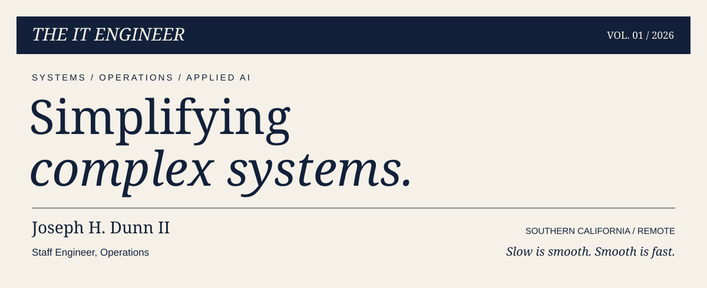

  <a href="https://joevisualstoryteller.github.io/joevisualstoryteller/">Explore my portfolio</a> ·
  <a href="https://www.linkedin.com/in/josephdunn0423/">LinkedIn</a> ·
  <a href="mailto:jdunn0423@gmail.com">Get in touch</a>

---

### A systems engineer by trade. A force enabler for teams.

I'm Joseph, a **Staff Engineer, Operations**. My work connects infrastructure, security, automation, and applied AI with the people who keep production running.

I focus on simplifying complex systems, setting clear standards, and helping engineers own hard problems from start to finish.

### Inside this edition

| **01 / Infrastructure** | **02 / Operations** | **03 / Applied AI** |
| :--- | :--- | :--- |
| **Set the platform direction.** | **Build resilience into the work.** | **Turn ideas into operating capability.** |
| Repeatable provisioning, production platforms, and a clear path from architecture to delivery. | Security, recovery, and operating models that help teams respond with confidence. | AI connected to real workflows and internal knowledge, with human oversight where it matters. |

[**Read the selected work →**](https://joevisualstoryteller.github.io/joevisualstoryteller/#work)

---

### The operating philosophy

> Simplifying complex systems. Slow is smooth. Smooth is fast. Master the basics.

**Southern California · Remote** 
Infrastructure · Operations · Security · Applied AI
